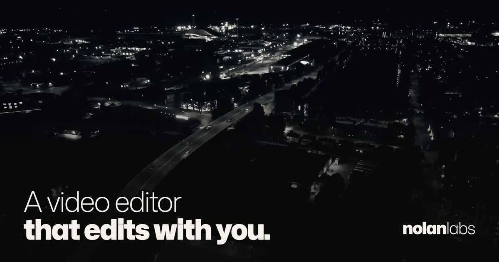

**nolanlabs is a video editor that edits with you.** Ask for a rough cut, a grade or a mix, and Nolan Edit, the agent built in, does it on your timeline. Its edits are outlined on the timeline as it works, each with its reason, and land as one step you can undo. On Mac (Apple silicon) and Windows.

- **Nolan Edit comes with the app.** It runs on NolanX, the model nolanlabs runs: every account has 100 credits a month, and a plan holds more. Nothing else to install.
- **Or bring your own agent.** Claude Code, Codex, Gemini CLI or any agent that speaks the Agent Client Protocol works on the same timeline, on your own account.
- **Lite and Pro.** A simple editor for a quick video, and the full one with tracks, trim tools, node grading and delivery. Both open the same projects.
- **Fits how you already cut.** Keys follow DaVinci Resolve, and projects travel as OTIO, FCPXML, EDL and AAF.

**[Download nolanlabs →](https://nolanlabs.io/download)**

[nolanlabs.io](https://nolanlabs.io/) · [Docs](https://nolanlabs.io/docs) · [Pricing](https://nolanlabs.io/pricing) · [Changelog](https://nolanlabs.io/changelog) · [hello@nolanlabs.io](mailto:hello@nolanlabs.io)
